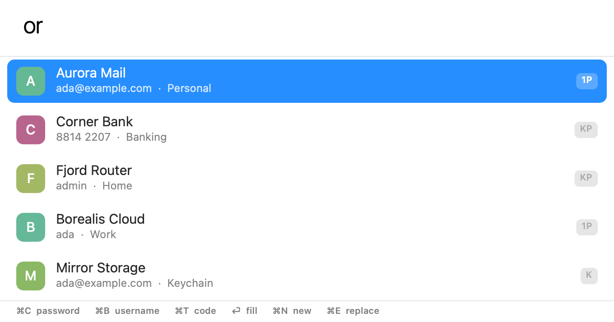

<div align="center">


# Sesam 🔑

**One search bar over 1Password, KeePassXC and the Apple Keychain.**



</div>

## Install

### Homebrew (recommended)

```sh
brew install john-athan/tap/sesam
cp -R "$(brew --prefix sesam)/Sesam.app" /Applications/
open /Applications/Sesam.app
```

Homebrew builds from source on your machine, so there is no "unidentified developer"
prompt, and `sesam` is on your `PATH` right away. The copy in `/Applications` is the
one macOS will start at login. `brew upgrade sesam` updates it; copy it again after.

### From source

```sh
git clone https://github.com/john-athan/sesam && cd sesam && make install
```

One minute. Builds with `swiftc`, copies `Sesam.app` to `/Applications`, launches it
and links the `sesam` command. No Xcode project, no package manager, nothing
downloaded. `make uninstall` takes it all away again.

### Then, in order

1. Press **⌥Space**. The bar appears. That is the whole interface.
2. Menu bar 🔑 ▸ Settings ▸ **Launch at login**, or the hotkey dies at the next restart.

## The keys

Type to search, arrows to move. Then:

| key | does |
|-----|------|
| `⌘C` | copy the password |
| `⌘B` | copy the username |
| `⌘T` | copy the one-time code |
| `Enter` | paste the password into the app you came from |
| `⌘N` | new login, password generated by the vault |
| `⌘E` | replace this entry's password |
| `⌘⇧R` | show the password in the row for ten seconds |
| `Esc` | never mind |

The panel prints this along the bottom, so there is nothing to remember.

## Connect the vaults

**Keychain** works immediately. Nothing to set up.

**1Password**: `brew install 1password-cli`, then switch on "Integrate with 1Password
CLI" in the desktop app's Developer settings. Touch ID authorises the first call and
the session covers the rest. The first index takes about three seconds.

**KeePassXC**: menu ▸ Settings ▸ **Choose the KeePassXC database**, once. After that,
unlock from the bottom row of the panel. The master password goes to `keepassxc-cli`
on stdin, and is wiped as soon as the database is open.

> Passwords saved by Safari and shown in the Passwords app live in the iCloud
> keychain, behind an entitlement Apple does not issue to third parties. No
> third-party app can read them, Sesam included.

## What it does with a password

1. The search index holds titles, usernames, URLs and vault names. No passwords.
2. A password is fetched on the keystroke that asks for it, into a byte buffer that
   overwrites itself.
3. The clipboard is marked `org.nspasteboard.ConcealedType` so clipboard managers
   skip it, and cleared after 30 seconds.
4. The panel is `sharingType = .none`, so it never appears in a screen recording.
5. Locking is real: on sleep, on screen lock, after 15 idle minutes, or `sesam lock`.

Full detail, including what Sesam cannot defend against, is in [SECURITY.md](SECURITY.md).

## Writing

`⌘N` creates a login. `⌘E` replaces one password. Both times the vault generates the
value, never Sesam: `op` and `keepassxc-cli` have audited generators, and a password
passed to another program as an argument is readable by every process on the Mac
through `ps`. The new password lands on your clipboard.

The keychain stays read only.

## One-time codes

`⌘T`. 1Password computes its own. KeePassXC's are counted here from the seed in the
database, checked against RFC 6238's own test vectors, because asking `keepassxc-cli`
would mean the master password and an Argon2 hash on every key press.

## Site icons

Off by default. Switch them on in the menu and each site is asked once for its own
favicon, never a shared icon service, which would hand one company the list of every
place you have an account. Requests carry no cookies. The cache is named by hashes and
is deleted when you switch the setting off.

## CLI

```sh
sesam            # launch the menu bar app
sesam search     # open the panel, same as ⌥Space
sesam status     # what is configured, and whether the app is running
sesam index      # count what each source can see, without showing any of it
sesam lock       # drop every unlocked vault right now
```

No command prints a password. That would put it in a shell history, a scrollback
buffer and quite possibly a screen share.

## Build

```sh
make build
make test        # 195 checks, about 10 seconds
```

One `swiftc` call over `Sources/`. The tests compile the whole app minus `main.swift`
and call every `func run<Something>Tests()` they find. Nothing in the suite needs a
vault, a window or a password: the parsers, the ranking and the geometry are pure
functions over fixtures.

## Permissions

One, for one feature. `Enter` posts a synthetic ⌘V, and macOS gates that behind
Accessibility. Copying does not, so `⌘C` works the minute it is installed.

The grant is attached to a code identity, and Sesam is ad-hoc signed, so that
identity is a hash of the binary. Every update and every rebuild produces a new hash,
and macOS treats it as a different app: the switch in System Settings stays on, yet
Sesam asks for the permission again the next time you press `Enter`. Turning the
switch off and on does not help. After each update:

1. Open System Settings → Privacy & Security → Accessibility.
2. Select Sesam and remove it with the minus button.
3. Press `Enter` in Sesam and allow it, or add `/Applications/Sesam.app` with the
   plus button.

## The decisions

Seven of them, each with what it gets wrong, in [docs/adr](docs/adr/README.md). Start
with [why Sesam reads the .kdbx](docs/adr/0001-reading-the-kdbx-instead-of-asking-keepassxc.md)
instead of talking to KeePassXC.

## License

MIT. Depends on two programs it does not ship: `keepassxc-cli` (GPL-3.0) and `op`
(proprietary), both installed separately and both run as child processes.
[THIRD_PARTY.md](THIRD_PARTY.md) sets out what that does and does not mean. Not
affiliated with AgileBits, the KeePassXC team, or Apple.
